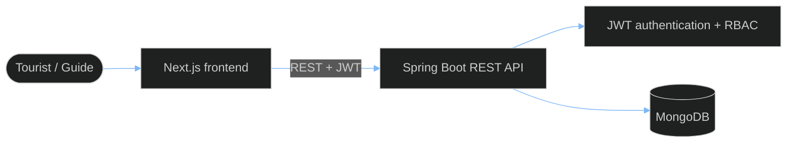
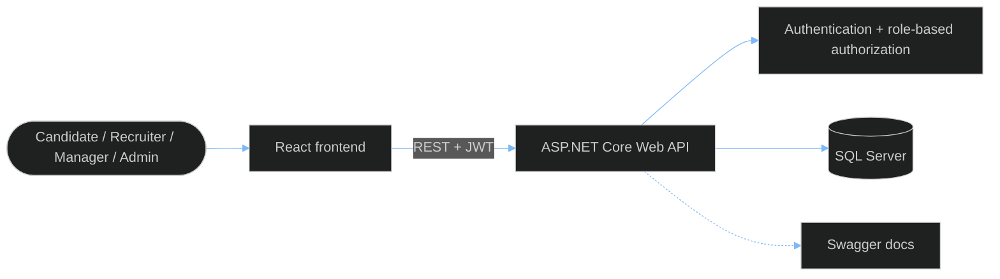

<!-- ================================ HERO ================================ -->

 

  

 

<!-- ================================ ABOUT ================================ -->

 

<table border="0">
<tr>
<td width="62%" valign="top">

### 👋 Hello, I'm Navindu

I'm a **Computer Science undergraduate** at NSBM Green University, focused on building scalable applications, modern user experiences and practical digital solutions.

I enjoy working across the development lifecycle, from **UI/UX and frontend** to **backend APIs, databases and authentication**, and I'm looking for a software engineering internship to grow with a professional team.

- 🚀 Full-stack web development
- ⚙️ Backend & REST API engineering (JWT, RBAC)
- 📱 Cross-platform mobile apps with Flutter
- 🎨 UI/UX design and prototyping
- 🗄️ Database design and management

</td>
<td width="38%" valign="top">

**At a glance**

| | |
| :-- | :-- |
| 🎓 Degree | BSc (Hons) Computer Science |
| 🏛️ University | NSBM Green University |
| 📅 Studying | Feb 2025 – Present |
| 📊 GPA | 3.80 / 4.00 |
| 📍 Location | Kurunegala, Sri Lanka |
| 🗣️ Languages | Sinhala (native), English (working) |

</td>
</tr>
</table>

 

<!-- ================================ STACK ================================ -->

 

**💻 Languages & Frameworks**

 

 

 

  

**🗄️ Databases**

  

**🛠️ DevOps & Tools**

  

**🎨 Design & Creative**

 

<!-- ================================ PROJECTS ================================ -->

 

<table border="0" cellspacing="12" cellpadding="0">
<tr>
<td width="50%" valign="top">

### 🗺️ MyTourBuddy
**Tourism & Guide Platform**

`Next.js` `Spring Boot` `MongoDB` `JWT`

A full-stack tourism platform connecting tourists with local guides in Sri Lanka.

**Focus:** Full-stack · REST API · JWT & RBAC 

</td>
<td width="50%" valign="top">

### 💼 ApexHire
**Recruitment Management System**

`React` `ASP.NET Core` `SQL Server` `JWT` `Swagger`

A role-based platform for candidates, recruiters, hiring managers and administrators: jobs, applications and interview scheduling.

**Focus:** Full-stack · .NET · Database 

</td>
</tr>
<tr>
<td width="50%" valign="top">

### ☀️ SunSide
**Smart Bus Seating Assistant**

`Flutter` `Dart` `Figma`

A mobile app concept to help passengers in Sri Lanka choose the bus seat side that may get less direct sunlight.

**Focus:** Mobile · UI/UX 

</td>
<td width="50%" valign="top">

### 🚆 RDMNS.LK
**Railway Experience Redesign**

`Figma` `Wireframing` `Prototyping` `HCI`

A Human-Computer Interaction redesign focused on live train alerts, accessibility and usability.

**Focus:** UI/UX · Prototyping 

</td>
</tr>
<tr>
<td width="50%" valign="top">

### 🌿 Baburugama Ayurvedic Medicine
**Brand & Label Design**

`CorelDRAW` `Photoshop` `Canva`

Product labels and branding materials in Sinhala, Tamil and English (Oct 2025 – Present).

**Focus:** Branding · Typography 

</td>
<td width="50%" valign="top">

### 🎬 Creative Media
**Travel & Video Storytelling**

`DaVinci Resolve` `Adobe Audition` `YouTube`

Travel, music and video content created and edited by me.

**Focus:** Content · Video · Audio 

</td>
</tr>
</table>

<b>🧩 More projects</b>

 

| Project | Description | Tech | Status |
| :-- | :-- | :-- | :-- |
| **CoreConnect** | Healthcare eChanneling UI/UX: doctor search, profiles and appointment booking | Figma, Prototyping, HCI | UI/UX concept |
| **RDBMS Project** | Database design with ER diagrams, relational modelling and SQL | SQL | Academic |
| **Code Game** | Game-like, interactive coding practice | Flutter | 🚧 In progress |

<b>🏗️ Architecture: MyTourBuddy</b>

 

<b>🏗️ Architecture: ApexHire</b>

 

 

<!-- ================================ NOW ================================ -->

 

| Project | What it is | Status |
| :-- | :-- | :-- |
| 🏠 **HODAMA THENA** | Smart boarding and accommodation platform for students and working individuals |  |
| 🩺 **MOH / PHI Management System** | Digitizing School Medical Inspections and public health workflows (Flutter, Dart) |  |
| 🎮 **Code Game** | Interactive coding practice built with Flutter |  |
| 🧸 **Teddy & Gift Heaven** | Online gift shop with product browsing |  |

 

<!-- ================================ STATS ================================ -->

  

 

  

 

<picture>
  <source media="(prefers-color-scheme: dark)" srcset="https://raw.githubusercontent.com/NavinduRanasinghe691/NavinduRanasinghe691/output/github-snake-dark.svg" />
  
</picture>

 

<!-- ================================ ACHIEVEMENTS ================================ -->

 

| | Achievement / Credential | Details |
| :-: | :-- | :-- |
| 🥉 | **Third Place**, ICT Students Competition | Divisional level, St. Anne's College |
| 🏁 | **UNSCRIPTED 1.0 Human Intelligence Hackathon** | Participant & Developer, May 2026 (Generation Alpha, Square Hub & Microsoft) |
| 🤖 | **Getting Started with Generative AI** | IBM SkillsBuild |
| 💻 | **Java Basic** | HackerRank |
| 🗄️ | **SQL Basic** | HackerRank |
| 🎓 | **Microsoft Student Ambassadors Event** | Participation |
| 🛠️ | **DevForge Workshop** | IEEE SkillShare, participation |

 

<!-- ================================ CONNECT ================================ -->

  

  

  

