

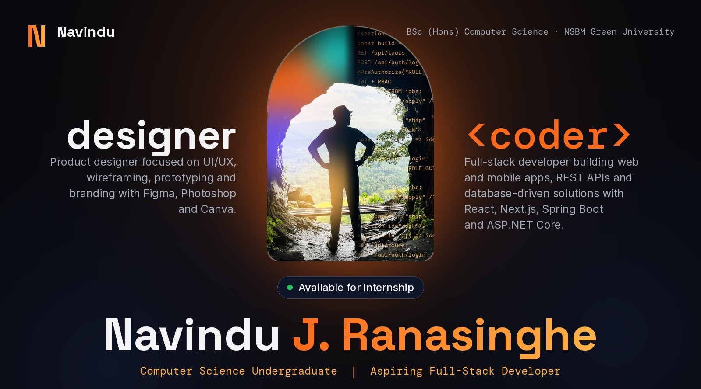

 

 

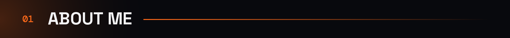

<table border="0">
<tr>
<td width="60%" valign="top">

### 👋 Hello, I'm Navindu

I'm a **Computer Science undergraduate** at NSBM Green University with a passion for full-stack development and creative technology. I enjoy building practical digital solutions: responsive web apps, REST APIs, database-driven systems, mobile apps and user-centered interfaces.

I'm continuously learning and looking for a **software engineering internship** where I can contribute, grow and build useful software with a professional team.

- 🚀 Full-stack web development
- ⚙️ Backend & REST APIs (JWT, role-based access control)
- 📱 Cross-platform mobile apps with Flutter
- 🎨 UI/UX design and prototyping

</td>
<td width="40%" valign="top">

| | |
| :-- | :-- |
| 🎓 **Degree** | BSc (Hons) Computer Science |
| 🏛️ **University** | NSBM Green University |
| 📅 **Studying** | Feb 2025 – Present |
| 📊 **GPA** | 3.80 / 4.00 |
| 📍 **Location** | Kurunegala, Sri Lanka |
| 🗣️ **Languages** | Sinhala (native), English (working) |

</td>
</tr>
</table>

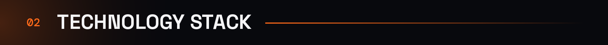

**Frontend** 

**Backend** 

**Mobile** 

**Databases** 

**UI/UX** 

**Tools** 

 

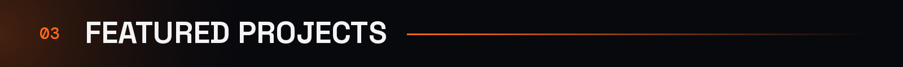

<table border="0" cellspacing="10">
<tr>
<td width="50%"><a href="https://github.com/NavinduRanasinghe691/REPLACE-WITH-REPO-NAME">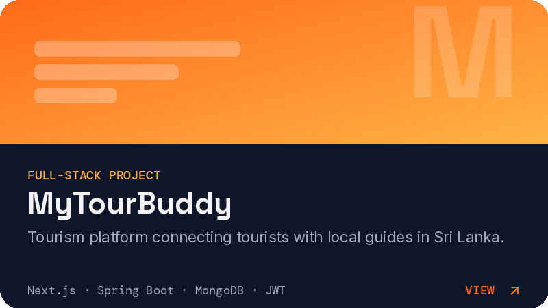</a></td>
<td width="50%"><a href="https://github.com/NavinduRanasinghe691/REPLACE-WITH-REPO-NAME">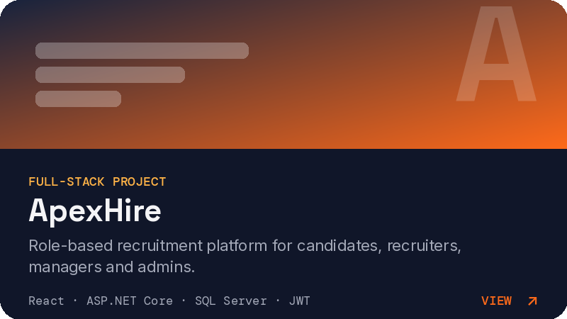</a></td>
</tr>
<tr>
<td width="50%"><a href="https://www.figma.com/">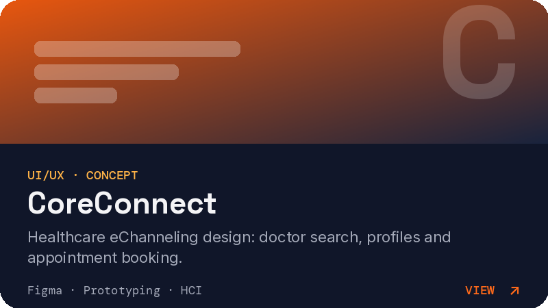</a></td>
<td width="50%"><a href="https://www.figma.com/">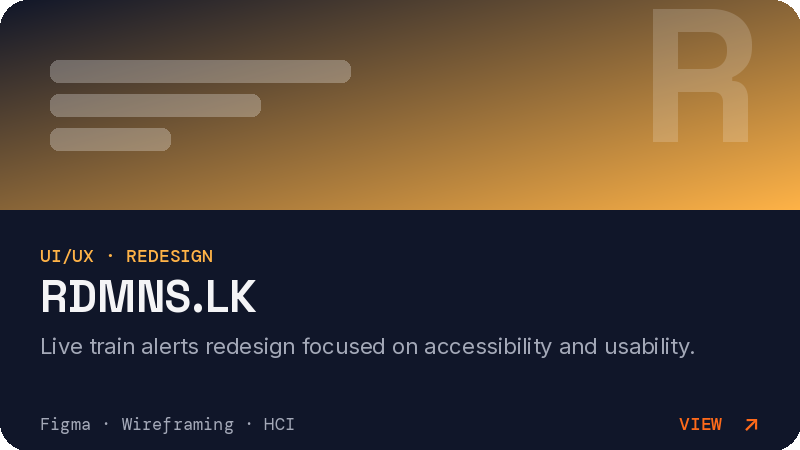</a></td>
</tr>
<tr>
<td width="50%"><a href="https://github.com/NavinduRanasinghe691/REPLACE-WITH-REPO-NAME">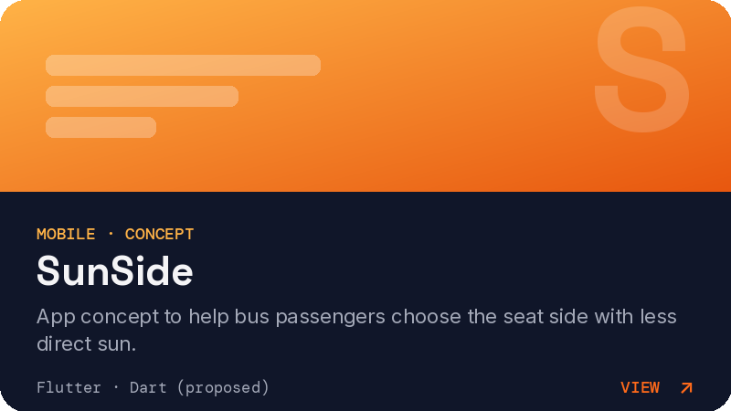</a></td>
<td width="50%"><a href="https://github.com/NavinduRanasinghe691/REPLACE-WITH-REPO-NAME">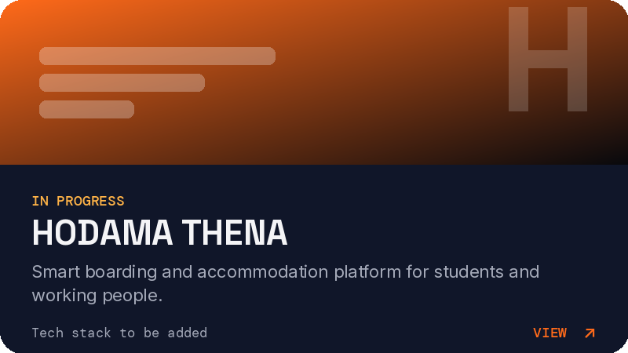</a></td>
</tr>
</table>

<b>🏗️ Architecture: MyTourBuddy</b>

 

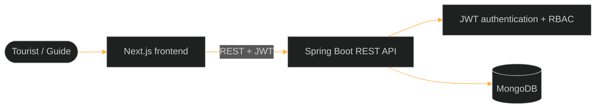

<b>🏗️ Architecture: ApexHire</b>

 

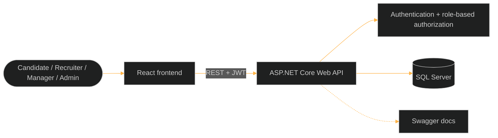

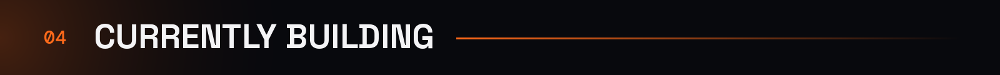

| Project | What it is | Tech | Status |
| :-- | :-- | :-- | :-- |
| 🏠 **HODAMA THENA** | Smart boarding and accommodation platform for students and working individuals | _to be added_ | 🚧 In progress |
| 🩺 **MOH / PHI Management System** | Digitizing School Medical Inspections and public health workflows | Flutter, Dart | 🚧 In progress |
| 🎮 **Code Game** | Interactive, game-like coding practice | Flutter | 🚧 In progress |
| 🧸 **Teddy & Gift Heaven** | Online gift shop with product browsing | _to be added_ | 🚧 In progress |

<b>🧩 Other work</b>

 

| Project | Description | Type |
| :-- | :-- | :-- |
| **RDBMS Project** | Database design with ER diagrams, relational modelling and SQL | Academic |
| **Baburugama Ayurvedic Medicine** | Product labels and branding materials in Sinhala, Tamil and English (Oct 2025 – Present) | Design work |

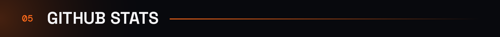

<picture>
  <source media="(prefers-color-scheme: dark)" srcset="https://raw.githubusercontent.com/NavinduRanasinghe691/NavinduRanasinghe691/output/github-snake-dark.svg" />
  
</picture>

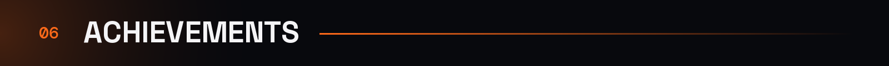

| | Achievement / Credential | Details |
| :-: | :-- | :-- |
| 🥉 | **Third Place**, ICT Students Competition | Divisional level, St. Anne's College |
| 🏁 | **UNSCRIPTED 1.0 Human Intelligence Hackathon** | Participant & Developer, May 2026 |
| 🤖 | **Getting Started with Generative AI** | IBM SkillsBuild |
| 💻 | **Java Basic** | HackerRank |
| 🗄️ | **SQL Basic** | HackerRank |
| 🎓 | **Microsoft Student Ambassadors Event** | Participation |
| 🛠️ | **DevForge Workshop** | IEEE SkillShare, participation |

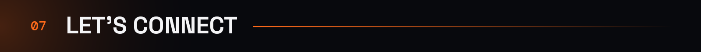

Open to **Full-Stack · Software Engineer · Frontend · Backend · Mobile** internship opportunities.

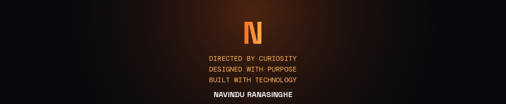

